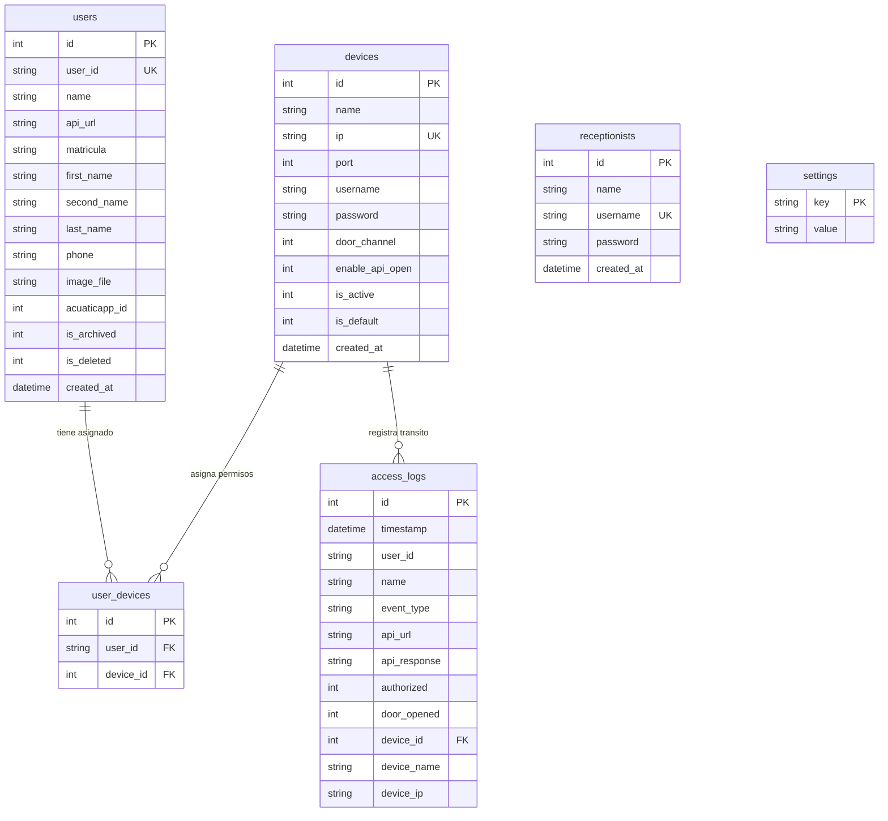
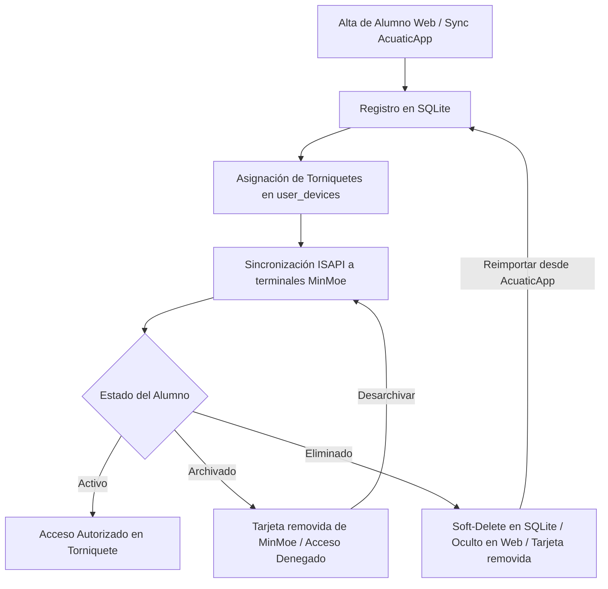

# Guía Técnica: Arquitectura, Protocolos y Referencia del Sistema
## Torniquete Link - Servidor de Integración Hikvision ISAPI + Express + SQLite

Esta guía técnica detalla la arquitectura de software, el modelo de datos relacional, los protocolos de comunicación ISAPI con las terminales MinMoe y el catálogo completo de APIs del sistema de control de accesos.

---

## 1. Arquitectura General del Sistema

El sistema implementa una arquitectura modular desacoplada basada en el patrón **MVC/Routing** sobre **Node.js**:

```text
Torniquete/
├── config/
│   └── database.js            # Esquema relacional SQLite3, migraciones automáticas y consultas
├── controllers/
│   ├── accessController.js    # Receptor de eventos ISAPI, validación de APIs externas y SSE
│   ├── authController.js      # Sesiones, autenticación RBAC y gestión de recepcionistas
│   ├── settingsController.js  # Gestión de dispositivos MinMoe, logs y configuración general
│   └── userController.js      # CRUD de alumnos, estados (archivar/eliminar) y sync AcuaticApp
├── middleware/
│   ├── auth.js                # Validación de sesiones, protección de rutas y control de roles
│   ├── bodyParsers.js         # Decodificador multiformato (JSON, URL-encoded, Raw XML y Multipart)
│   └── requestLogger.js       # Registro de peticiones HTTP en terminal con timestamps
├── routes/
│   ├── api.js                 # API REST para administración y consumo del frontend
│   └── device.js              # Webhooks de captura de eventos emitidos por los lectores MinMoe
├── utils/
│   ├── device.js              # Cliente ISAPI (Digest Auth, apertura remota, sincronización y ping)
│   └── logger.js              # Emisor de eventos del sistema y bus Server-Sent Events (SSE)
├── scripts/
│   └── sync-all-to-device.js  # Script de línea de comandos para sincronización masiva a MinMoe
├── public/                    # Frontend SPA ligero (HTML5, Vanilla JS, Glassmorphic CSS)
│   ├── app.js                 # Lógica del cliente administrativo y reactividad
│   ├── feedback.html          # Pantalla de confirmación visual y auditiva para el alumno
│   ├── index.html             # Dashboard principal de administración y monitoreo
│   ├── login.html             # Pantalla de autenticación para administradores y recepcionistas
│   ├── pruebas.html           # Entorno de pruebas y simulador de escaneos
│   └── style.css              # Sistema de diseño responsivo
├── database.sqlite            # Base de datos local transaccional
└── server.js                  # Punto de entrada de la aplicación y escucha de puertos
```

---

## 2. Modelo de Datos Relacional (SQLite3)

La base de datos reside en el archivo `database.sqlite` y cuenta con claves foráneas e índices de búsqueda rápida:



### Detalle de Tablas:

1. **`users` (Padrón de Alumnos):**
   * Almacena los datos personales, matrícula y enlaces de validación externa.
   * `is_archived` (BOOLEAN): `1` revoca el acceso temporalmente sin borrar el alumno.
   * `is_deleted` (BOOLEAN): `1` oculta el registro de la web (*Soft-Delete*), preservando auditorías y logs previos.

2. **`devices` (Terminales MinMoe / Torniquetes):**
   * Configuración de conexión ISAPI de cada lector físico (`ip`, `port`, `username`, `password`, `door_channel`).
   * `is_default` (BOOLEAN): Define el torniquete principal del sistema para canalizar eventos sin IP identificada o aperturas manuales rápidas.

3. **`user_devices` (Matriz de Permisos Usuario $\leftrightarrow$ Torniquete):**
   * Vincula qué alumnos tienen acceso autorizado en cuáles torniquetes. Si un alumno no cuenta con asignaciones explícitas, el sistema aplica acceso al dispositivo predeterminado.

4. **`receptionists` (Cuentas de Operadores):**
   * Usuarios de rol `receptionist` autorizados para operar la recepción diaria sin acceso a la configuración técnica.

5. **`access_logs` (Historial de Transacciones):**
   * Auditoría de cada intento de acceso con fecha, credencial (tarjeta, QR, rostro), respuesta de la API externa, veredicto y confirmación de apertura del torniquete.
   * Cuenta con purga automática periódica para optimizar el tamaño de la base de datos.

6. **`settings` (Ajustes de Compatibilidad y Clave Maestra):**
   * Pares clave-valor (`admin_password`, `device_ip`, etc.) que mantienen compatibilidad histórica con scripts externos.

---

## 3. Protocolos de Integración Hikvision ISAPI

El sistema interactúa con los biométricos Hikvision mediante el estándar **ISAPI** (*Intelligent Security API*):

### A. Recepción de Eventos de Acceso (Webhook / HTTP Listening)
Cuando un alumno presenta su rostro, huella, tarjeta o QR:
1. El MinMoe envía un `POST` al endpoint raíz del servidor (`/`, `/event`, `/remoteCheck`).
2. El cuerpo suele llegar en formato `multipart/form-data` con límites MIME boundary conteniendo descriptores XML o JSON.
3. El parser de respaldo en [`controllers/accessController.js`](file:///home/yucef_U/Chamba/Torniquete/controllers/accessController.js) extrae el identificador del alumno mediante expresiones regulares de alta velocidad:
   * `/<employeeNoString[^>]*>([^<]+)<\/employeeNoString>/`
   * `/<cardNo[^>]*>([^<]+)<\/cardNo>/`
4. **Detección Silenciosa de Heartbeats:** Las peticiones periódicas de latido de vida (`eventType: "heartBeat"`) se responden con `200 OK` inmediatamente sin registrarse en los logs para evitar saturación de I/O.

### B. Autenticación HTTP Digest (RFC 2617)
Toda comunicación hacia el MinMoe utiliza autenticación Digest:
1. El servidor envía una petición sin autorización para recibir el desafío `401 Unauthorized` con los parámetros `realm`, `nonce`, `qop` y `opaque`.
2. Se calcula el hash de autenticación MD5:
   $$\text{HA1} = \text{MD5}(\text{username} : \text{realm} : \text{password})$$
   $$\text{HA2} = \text{MD5}(\text{HTTP\_METHOD} : \text{URI})$$
   $$\text{Response} = \text{MD5}(\text{HA1} : \text{nonce} : \text{nc} : \text{cnonce} : \text{qop} : \text{HA2})$$
3. Se reintenta la petición inyectando la cabecera `Authorization: Digest ...`.

### C. Comandos ISAPI Principales

| Operación | Método | Ruta ISAPI | Descripción |
| :--- | :---: | :--- | :--- |
| **Apertura de Puerta** | `PUT` | `/ISAPI/AccessControl/RemoteControl/door/<canal>` | Envía `<cmd>open</cmd>` para accionar el relevador físico del torniquete. |
| **Ping / Verificación Segura** | `GET` | `/ISAPI/System/deviceInfo` | Consulta información del equipo sin accionar las puertas ni abrir relevadores. |
| **Alta de Usuario** | `POST` | `/ISAPI/AccessControl/UserInfo/Record?format=json` | Graba el Nombre y `employeeNo` en la memoria del MinMoe. |
| **Alta de Tarjeta / QR** | `POST` | `/ISAPI/AccessControl/CardInfo/Record?format=json` | Asocia una credencial virtual (`cardNo = user_id`) al usuario para lectura QR directa. |
| **Eliminar Usuario** | `DELETE` | `/ISAPI/AccessControl/UserInfo/Record?employeeNo=<id>` | Retira al usuario y sus tarjetas asociadas del hardware MinMoe. |
| **Remote Check (Feedback)** | `PUT` | `/ISAPI/AccessControl/remoteCheck?format=json` | Envía la decisión al biométrico para que muestre el marco verde/rojo y reproduzca la voz. |

---

## 4. Ciclo de Vida del Alumno y Gestión de Estados



* **Prevención de Registros Huérfanos:**
  Si se modifica la matrícula o `user_id` de un alumno existente, el backend ejecuta automáticamente:
  1. `DELETE FROM user_devices WHERE user_id = <old_user_id>` para limpiar permisos previos.
  2. `DELETE /ISAPI/AccessControl/UserInfo/Record` hacia el MinMoe para retirar el ID anterior del biométrico antes de cargar el nuevo.

---

## 5. Integración con AcuaticApp (API v2)

La sincronización masiva interactúa con la API REST institucional:
1. **Autenticación:** `POST https://acuaticapp.com/api/v2/administration/login` con credenciales de escuela para obtener el `Bearer Token`.
2. **Paginación:** `GET https://acuaticapp.com/api/v2/administration/student/getStudents?page=X&per_page=50`.
3. **Mapeo de Campos:** Extrae `id`, `name`, `second_name`, `last_name`, `matricula`, `phone` e `image_file`.
4. **Reactivación Automática:** Si un alumno estaba marcado con `is_deleted = 1` o `is_archived = 1` pero viene activo en la respuesta de la escuela, el método `addUser` en [`config/database.js`](file:///home/yucef_U/Chamba/Torniquete/config/database.js) restablece automáticamente `is_deleted = 0` e `is_archived = 0`.

---

## 6. Catálogo de Endpoints de la API REST

### Autenticación y Sesiones
* `POST /api/login`: Inicia sesión con `username` y `password`; establece cookie de sesión firmada.
* `POST /api/logout`: Destruye la sesión activa.
* `GET /api/me`: Devuelve los datos y rol del usuario autenticado (`admin` o `receptionist`).

### Gestión de Recepcionistas (Solo Admin)
* `GET /api/receptionists`: Lista de cuentas de recepcionistas.
* `POST /api/receptionists`: Registra un nuevo recepcionista.
* `PUT /api/receptionists/:id`: Actualiza nombre, usuario o contraseña.
* `DELETE /api/receptionists/:id`: Elimina un recepcionista.

### Gestión de Alumnos
* `GET /api/users`: Lista de alumnos (soporta filtros `?device=`, `?status=active|archived|all` y búsqueda `?search=`). Incluye cabeceras anti-caché `Cache-Control: no-store`.
* `GET /api/users/:id/qr`: Genera la imagen PNG del código QR del alumno.
* `POST /api/users`: Registra un alumno y lo sincroniza con los torniquetes asignados.
* `PUT /api/users/:id`: Actualiza datos, matrícula y torniquetes.
* `DELETE /api/users/:id`: Eliminación lógica (*Soft-Delete*).
* `POST /api/users/:id/archive`: Alterna entre estado archivado y desarchivado.
* `POST /api/users/sync-all`: Sincroniza todo el padrón local hacia el MinMoe predeterminado.
* `POST /api/users/sync-acuaticapp`: Dispara la sincronización masiva desde AcuaticApp.

### Torniquetes / MinMoe
* `GET /api/devices`: Lista de torniquetes configurados con contraseña oculta (`••••••••`).
* `POST /api/devices`: Registra un torniquete (requiere rol Admin y contraseña obligatoria).
* `GET /api/devices/:id`: Obtiene datos de un torniquete específico.
* `PUT /api/devices/:id`: Actualiza parámetros de red o credenciales.
* `DELETE /api/devices/:id`: Elimina un torniquete.
* `POST /api/devices/test-ping` o `POST /api/devices/:id/test-ping`: Prueba segura de conectividad ISAPI.
* `POST /api/devices/:id/open-door`: Envía comando manual de apertura física.

### Historial y Monitoreo en Tiempo Real
* `GET /api/logs`: Consulta registros históricos con soporte de paginación y filtro por torniquete.
* `GET /api/stats`: Estadísticas acumuladas (total, autorizados, denegados y tasa de éxito).
* `POST /api/logs/clear`: Purga manual de logs (Solo Admin).
* `GET /api/logs-stream`: Canal Server-Sent Events (SSE) para recepción de eventos en tiempo real.
* `GET /api/devices/:id/events-stream`: Canal SSE dedicado exclusivamente para un torniquete.

---

## 7. Alta Disponibilidad y Resiliencia

1. **Auto-Recuperación ante Caídas:** Mediante PM2 en Linux (`pm2 startup`) o NSSM en Windows, el proceso se reinicia automáticamente en 1 segundo ante cualquier error o corte de energía.
2. **Operación Offline:** Los alumnos sin enlace externo o registrados en contingencia reciben validación local garantizada (`/api/mock-external-api/allow`), asegurando el libre tránsito escolar sin depender de conexión a internet.
3. **Mantenimiento Automatizado:** En el arranque y de forma periódica, el sistema ejecuta limpieza de registros antiguos en SQLite para preservar el alto rendimiento en discos mecánicos o tarjetas SD.
